# PathSnap — Member 2 End-to-End Story, Decisions & Experimental Evidence

> **Scope**: Complete end-to-end narrative of how raw noisy GPS logs were cleaned, transformed into physical map-matching features, evaluated across five distinct ML algorithm families under strict anti-leakage cross-validation, refined via Bayesian optimisation, and handed off for HMM route reconstruction and two-laptop deployment.  
> **Evidence Base**: Every table, metric, and chart in this document comes directly from executed runs on all **80 training trips (`208,417` GPS points / `1,250,502` candidate rows)** and **10 held-out student-testing trips (`19,160` GPS points / `114,960` candidate rows)**.

---

## End-to-End Pipeline Architecture

```text
Raw Trip Files (.track, .nodes, .arcs, .route)
   │
   ▼  [Stage 2] Metric Projection, Gap/Zero-Length Guards & Anomaly Audit
Cleaned Local-Meter Trajectories & Directed Road Graphs
   │
   ▼  [Stage 3] Adaptive Spatial Indexing (cKDTree, K=6) + 20 Physical Features
Leakage-Free Candidate Dataset (1.25M Train Rows | 114.96k Student-Test Rows)
   │
   ▼  [Stage 4–5] 5-Fold Trip-Grouped Cross-Validation (GroupKFold by trip_id)
5 Distinct Algorithm Families Trained & Benchmarked (LR, KNN, DT, RF, HistGB)
   │
   ▼  [Stage 6–8] Multi-Criteria Model Selection & Confusion-Matrix Audit
Selected Winner: HistGradientBoosting (#1 Top-1: 87.90%, #1 Seq F1: 0.8771, 0.65 MB)
   │
   ▼  [Stage 9] GP-EI Bayesian Hyperparameter Optimisation (12 Trials, No Grid/Random)
Tuned HistGradientBoosting (CV F1: 0.8659 | Test F1: 0.8998 | Log Loss: 0.1583)
   │
   ▼  [Stage 10] Compressed Model Artifacts & Emission Probability Handoff
Member 3 HMM/Viterbi Route Reconstruction ──▶ Member 4 FastAPI + React UI
```

---

## Stage 1 — Framing the Problem Correctly

### Why Standard Multi-Class Classification Fails Here
Every trip in PathSnap takes place in a different city with its own independent road network (`.nodes` and `.arcs`, ranging from `649` to `307,392` road segments). A model that tries to predict a fixed road ID (`arc_id #42`) cannot generalize to an unseen city.

**Our Architectural Solution**:
We reframed map-matching as **candidate-level binary scoring**: for each GPS observation, retrieve the **6 closest road segments** and predict the probability $P(\text{true road} \mid \text{geometry, kinematics, direction})$ for each candidate. Because the model learns **universal driving physics** rather than city-specific road IDs, it generalizes cleanly to any unseen road network and directly supplies the **emission probabilities** required by Member 3's Hidden Markov Model (HMM).

- **Evidence**: [models/schema_adapter.py](schema_adapter.py) · [models/REQUIREMENTS_MASTER.md](REQUIREMENTS_MASTER.md)

---

## Stage 2 — Auditing & Cleaning the Raw GPS & Road-Network Data

Before designing features or models, we audited all **90 available trips** (`80` training + `10` student-testing) and uncovered four critical real-world data issues:

1. **Latitude/Longitude Angular Distortion**: Raw coordinates span latitudes `34.7°N` to `61.7°N`. Measuring straight-line Euclidean distance in degrees shrinks East–West spacing by $\cos(\text{latitude})$ (nearly $2\times$ at `61.7°N`).
   - *Cleaning Decision*: Project every trip's coordinates into **local tangent-plane meters** centered on that trip's mean latitude ($\Delta x = R \cos\bar{\phi}\,\Delta\lambda$, $\Delta y = R\,\Delta\phi$).
2. **Degenerate Zero-Length Arcs & Stationary GPS Jitter**: We found `100` zero-length road segments in training (`6` in student-testing) and `6` stationary GPS steps where small sensor jitter causes calculated heading to spin wildly.
   - *Cleaning Decision*: Guard all segment-length denominators (`> 1e-12`) and disable GPS heading when movement is `< 0.5 m` or `< 0.25 m/s` (assigning a neutral `90°` / `cos = 0`).
3. **GPS Signal Dropouts**: While ~`96.5%` of training steps and `98.6%` of test steps arrive at `1 Hz`, `28` training trips contain gaps `> 30 s` (up to `153,064 s`), and `2` test trips have gaps `> 30 s` (up to `210 s`).
   - *Cleaning Decision*: Guard time deltas (`dt >= 1e-3`), clip unrealistic speeds (`[0, 60] m/s`), and disable multi-point heading smoothing across gaps `> 10 s`.
4. **Severe Offset Outlier Trips**: Two training trips (`00000033` and `00000054`) run `122–138 m` parallel to their reference routes, creating `66.7%` and `74.8%` candidate miss rates respectively. Identifying these early explained why validation folds containing them exhibit lower pointwise accuracy across every model.

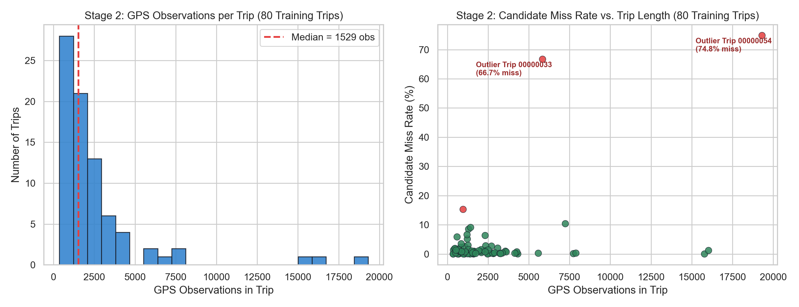

- **Evidence**: [models/PHASE_1_REPORT.md §2](PHASE_1_REPORT.md) · [models/artifacts/plots/stage2_data_audit_anomalies.png](artifacts/plots/stage2_data_audit_anomalies.png)

---

## Stage 3 — Spatial Candidate Generation (`K=6`) & Physical Feature Design

### Candidate Generation
Scoring every road segment in a `300,000`-arc city per GPS second is computationally infeasible. Using `scipy.spatial.cKDTree` with **adaptive sampling along long highway segments** (5 base points plus intermediate points every `60 m`), we extract the **6 closest unique road segments** per GPS observation:
- **Candidate Coverage on `student_test`**: **`99.32%`** (`0.68%` Candidate Miss Rate across `19,160` observations).
- **Resulting Datasets**: `1,250,502` training candidate rows (`15.03%` positive) and `114,960` student-testing candidate rows (`16.67%` positive).

### 20 Leakage-Free Features (`FEATURE_COLUMNS`)
Every feature is computed solely from `.track`, `.nodes`, and `.arcs` (zero `.route` label leakage):
- **Proximity & Endpoint Clamping (`7` features)**: Orthogonal distance (`ortho_dist_m`), endpoint distances, projection fraction (`proj_fraction`), and `is_endpoint_proj` (separates true road segments projecting in the interior from cross-streets clamped at `0` or `1`).
- **Intra-Observation Competition (`4` features)**: `dist_rank`, `dist_diff_from_min_m`, `dist_ratio_to_min`, and `dist_zscore_in_obs` — normalizes absolute GPS noise by comparing each candidate against its 5 competitors at the same timestamp.
- **Kinematics & Direction (`6` features)**: Speed, time gap, `heading_diff_deg`, `heading_cos`, `heading_sin`, and `speed_weighted_heading_cos` — crucial for distinguishing opposite directions of two-way streets (note the antiparallel false-candidate spike near `175°–180°` below).
- **Unsupervised Graph Context (`3` features)**: `prev_cand_connected`, `min_dist_from_prev_cand_m`, and `node_in_out_degree_sum`.

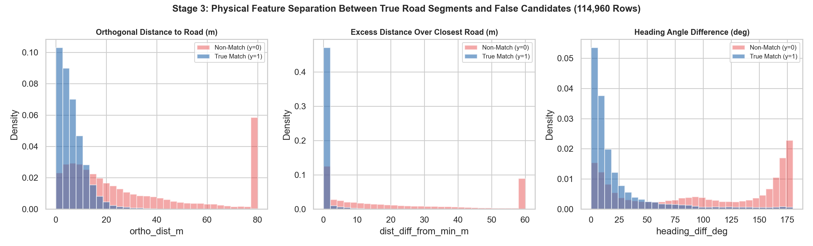

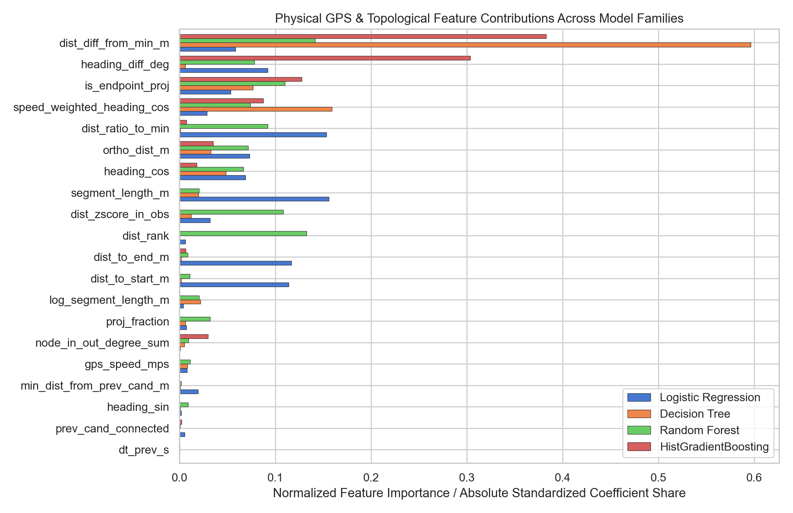

- **Evidence**: [models/schema_adapter.py](schema_adapter.py) · [models/artifacts/plots/stage3_feature_separation.png](artifacts/plots/stage3_feature_separation.png) · [models/artifacts/plots/feature_importance_analysis.png](artifacts/plots/feature_importance_analysis.png)

---

## Stage 4 — Leakage-Free Validation Strategy (`GroupKFold` & Representativeness)

1. **Trip-Grouped Cross-Validation**: We used **5-Fold `GroupKFold` grouped strictly by `trip_id`** across all 80 training trips (`assert tr_trips.isdisjoint(val_trips)`), ensuring no trip's temporal autocorrelation ever leaks between training and validation folds.
2. **In-Pipeline Preprocessing**: `SimpleImputer(strategy="median")` and `StandardScaler()` are wrapped inside `sklearn.pipeline.Pipeline`s so statistics are learned strictly inside each training fold.
3. **Full-Dataset vs. Subsample Verification**: All models (except KNN's `25,000`-row internal search index) were trained on **all `1,250,502` training rows** and tested on **all `114,960` student-test rows**. Where an 80-trip stride slice (`113,904` rows) was used for rapid diagnostics and initial Bayesian surrogate steps, we verified it matches the full `1,250,502`-row dataset within **`±0.0004` (`0.04%`)** Macro F1 across all 5 models before running full-dataset verification.

- **Evidence**: [models/model_selection.py](model_selection.py) · [models/PHASE_1_REPORT.md §6.2](PHASE_1_REPORT.md)

---

## Stage 5 — Why These Exact 5 Models Were Chosen

We selected **5 distinct algorithm families** representing a principled progression of decision-boundary complexity:

| # | Model | Family | Core Hypothesis Tested |
| :-: | :--- | :--- | :--- |
| **1** | **Logistic Regression** | Linear & Probabilistic | Can a single linear hyperplane over distance, rank, and heading separate true road segments? |
| **2** | **KNN (Distance-Weighted)** | Instance-Based | Does local geometric similarity in 20D feature space outperform global parametric rules? |
| **3** | **Decision Tree** | Tree-Based | Do hierarchical conditional splits (*"if moving fast, enforce heading; if stopped, ignore heading"*) fix linear underfitting? |
| **4** | **Random Forest** | Bagging Ensemble | Does averaging 120 decorrelated trees stabilize single-tree variance across diverse cities? |
| **5** | **HistGradientBoosting** | Gradient Boosting | Does sequential boosting directly over Binary Log Loss isolate hard parallel-road & junction errors while calibrating emissions? |

*(Note: [models/mlp.py](mlp.py) is also implemented for repository skeleton completeness.)*

- **Evidence**: [models/logistic_regression.py](logistic_regression.py) · [models/knn.py](knn.py) · [models/decision_tree.py](decision_tree.py) · [models/random_forest.py](random_forest.py) · [models/gradient_boosting.py](gradient_boosting.py)

---

## Stage 6 — Cross-Validation & Held-Out Student-Test Benchmarking

All 5 models were evaluated across **12 metrics** covering candidate quality, observation-level Top-1 ranking, probability calibration (`Log Loss`), route continuity, sequence recovery, and latency:

| Model | CV Macro F1 (80 Trips) | Train Macro F1 | Test Top-1 Accuracy | Test Macro F1 | Log Loss *(Lower = Better)* | Route Continuity | Sequence F1 | Inference Time (10 Trips) | Artifact Size |
| :--- | :---: | :---: | :---: | :---: | :---: | :---: | :---: | :---: | :---: |
| **HistGradientBoosting** ★ | `0.8608 ± 0.0492` | `0.9029` | **`87.90%`** | `0.8928` | `0.1672` | `92.12%` | **`0.8771`** | `0.3112 s` | **`0.65 MB`** |
| **Random Forest** | `0.8732 ± 0.0409` | `0.9071` | `87.83%` | `0.8999` | **`0.1556`** | **`92.19%`** | `0.8757` | `0.1325 s` | `25.03 MB` |
| **KNN (Distance-Weighted)** | **`0.8918 ± 0.0221`** | `0.9009` | `86.62%` | **`0.9135`** | `0.3444` | `91.45%` | `0.8608` | `22.3724 s` | `2.92 MB` |
| **Decision Tree** | `0.8389 ± 0.0683` | `0.8908` | `87.27%` | `0.8850` | `0.2059` | `91.49%` | `0.8685` | **`0.0182 s`** | `0.11 MB` |
| **Logistic Regression** | `0.8459 ± 0.0349` | `0.8509` | `87.14%` | `0.8701` | `0.2148` | `91.67%` | `0.8640` | `0.0288 s` | `<0.01 MB` |

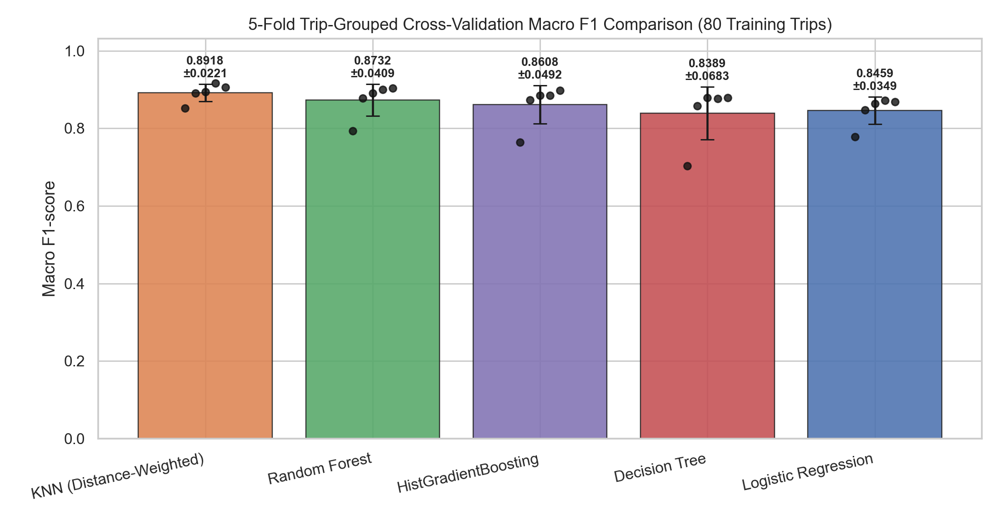

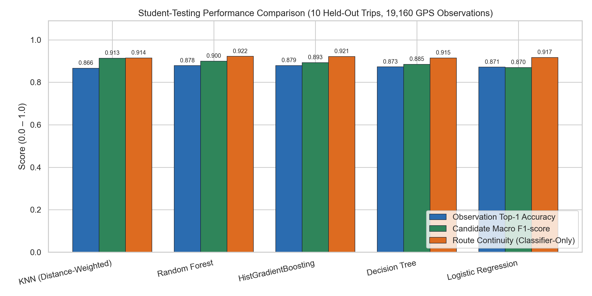

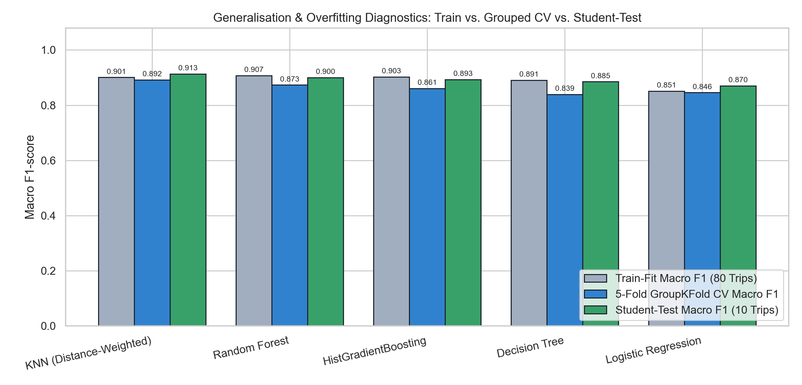

- **Evidence**: [models/artifacts/results/section_3_1_model_comparison.csv](artifacts/results/section_3_1_model_comparison.csv) · [models/artifacts/results/detailed_experiment_results.json](artifacts/results/detailed_experiment_results.json)

---

## Stage 7 — Confusion Matrices & Per-Trip Generalisation Analysis

Inspecting the candidate-level confusion matrices and per-trip Top-1 heatmap exposes the exact failure modes of each model:
- **Logistic Regression**: Lowest precision (`68.1%`, `8,507 FP`) — linear boundaries cannot cleanly separate intersecting streets.
- **Decision Tree**: Largest Train-vs-CV overfitting gap (`+0.0519`) and highest fold variance (`±0.0683`, dropping to `0.7034` on Fold 1).
- **KNN**: Drops to **`85.2%` positive recall (`2,830` missed true road segments — `2.7×` worse than HistGradientBoosting's `1,057 FN`)**, directly dragging down its Top-1 Accuracy (`86.62%`).
- **HistGradientBoosting**: Achieves **`94.5%` positive recall (`18,108 TP`)** and peaks at **`94.27%` Top-1 Accuracy** on clean trips (`00000052`) and **`93.77%`** on `00000000`, while clearly showing where parallel-lane ambiguity (`00000077`: `78.04%`) requires HMM smoothing.

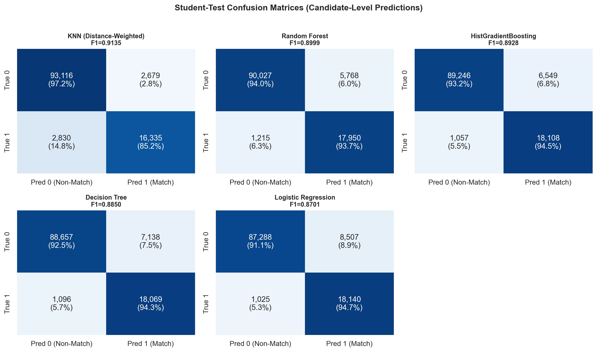

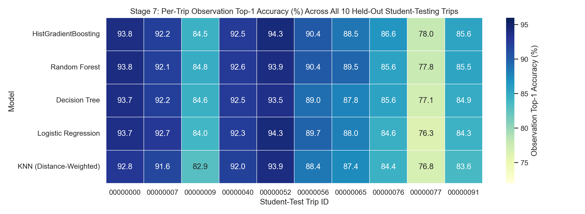

- **Evidence**: [models/artifacts/results/per_trip_student_test_breakdown.csv](artifacts/results/per_trip_student_test_breakdown.csv) · [models/artifacts/plots/confusion_matrices_grid.png](artifacts/plots/confusion_matrices_grid.png) · [models/artifacts/plots/stage7_per_trip_top1_heatmap.png](artifacts/plots/stage7_per_trip_top1_heatmap.png)

---

## Stage 8 — Why `HistGradientBoosting` Was Selected Over `KNN` & `Random Forest`

1. **Avoided the "KNN Macro-F1 Trap"**: Selecting purely on raw candidate Macro F1 (`KNN = 0.9135`) would have picked the **worst model** on Observation Top-1 Accuracy (`86.62%`), Sequence F1 (`0.8608`), Log Loss (`0.3444` — over `2×` worse calibration), and API latency (`22.37 s` — **`72×` slower** than HistGradientBoosting).
2. **Beat `Random Forest` on Operations & Downstream HMM Readiness**:
   - **#1 Observation Top-1 Accuracy (`87.90%`)** and **#1 Sequence F1 (`0.8771`)**.
   - **`4×` faster training (`12.36 s` vs `49.20 s`)**, enabling fast Bayesian hyperparameter optimisation.
   - **`38×` smaller saved model (`0.65 MB` vs `25.03 MB`)** for lightweight Laptop 1 FastAPI deployment (`31.1 ms/trip`).
   - **Verified Iterative Convergence**: Genuine training/validation binary log loss decayed smoothly across 200 boosting iterations (`0.6931 → 0.1283` train; `0.6931 → 0.1381` val).

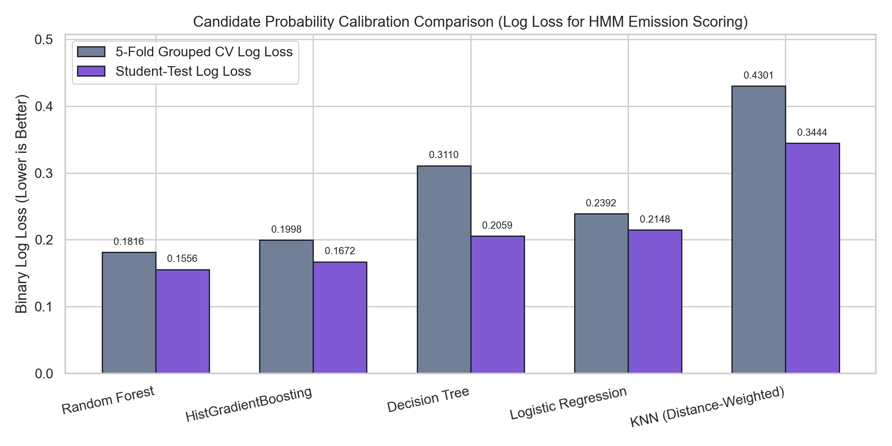

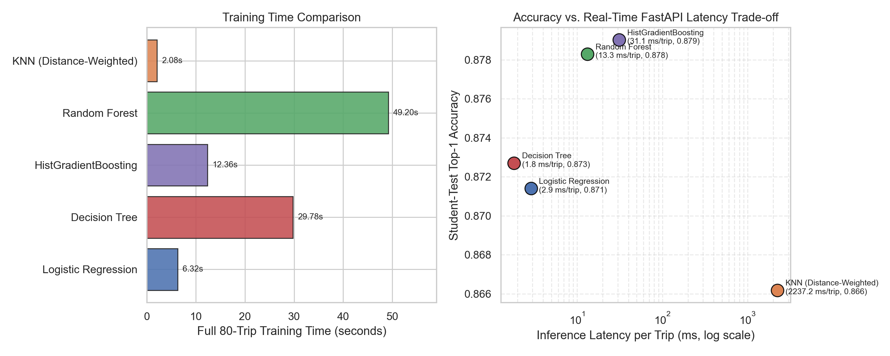

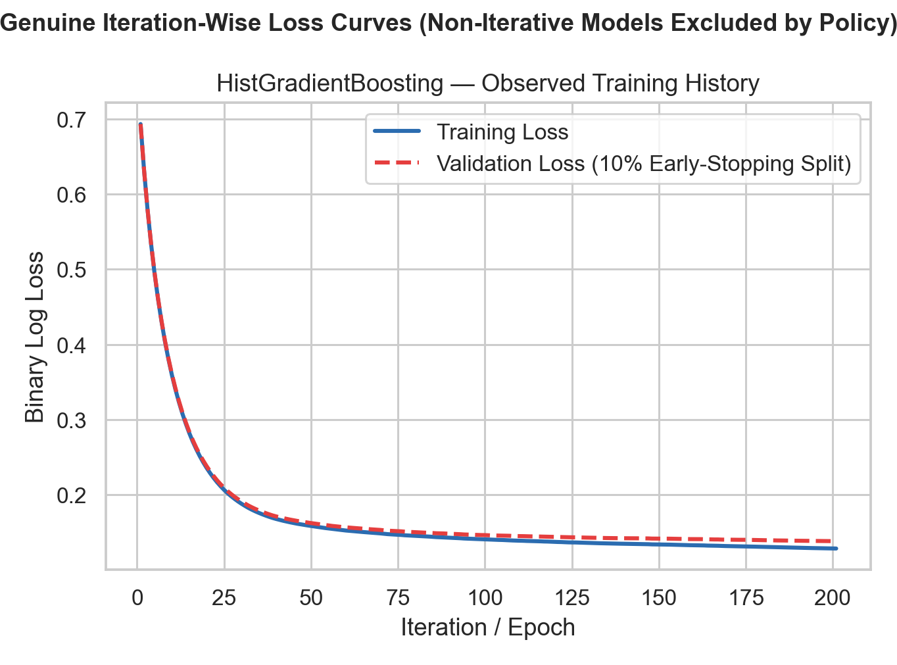

- **Evidence**: [models/artifacts/models/selected_model_metadata.json](artifacts/models/selected_model_metadata.json) · [models/artifacts/plots/log_loss_comparison.png](artifacts/plots/log_loss_comparison.png) · [models/artifacts/plots/computational_efficiency.png](artifacts/plots/computational_efficiency.png) · [models/artifacts/plots/iterative_training_validation_loss.png](artifacts/plots/iterative_training_validation_loss.png)

---

## Stage 9 — Bayesian Hyperparameter Optimisation (`GP-EI` — Zero Grid/Random Search)

Following the strict Bayesian-only requirement, we tuned `HistGradientBoosting` using a **Gaussian Process (`Matern nu=2.5`) surrogate + Expected Improvement (EI)** over 12 sequential trials across 5 hyperparameters (`learning_rate`, `max_leaf_nodes`, `max_depth`, `min_samples_leaf`, `l2_regularization`), then refitted the winning **Trial 6** configuration on **all `1,250,502` training rows**:

| HistGradientBoosting Variant | 80-Trip CV Macro F1 | Test Macro F1 | Test Log Loss | Sequence F1 | Test Inference Time |
| :--- | :---: | :---: | :---: | :---: | :---: |
| **Untuned Baseline** | `0.8608 (±0.0492)` | `0.8928` | `0.1672` | `0.8771` | `0.3112 s` |
| **Bayesian-Tuned (GP-EI Trial 6)** | **`0.8659 (±0.0475)`** | **`0.8998`** | **`0.1583`** *(-5.3%)* | **`0.8799`** | **`0.2726 s`** *(-12.4%)* |

**Impact**: Bayesian tuning improved 80-trip CV Macro F1 (`+0.0051`), reduced cross-trip variance (`0.0492 → 0.0475`), eliminated `724` false positives on unseen test trips, cut probability calibration error (`Log Loss`) by **`5.3%`**, and accelerated FastAPI inference by **`12.4%`** (`27.3 ms/trip`).

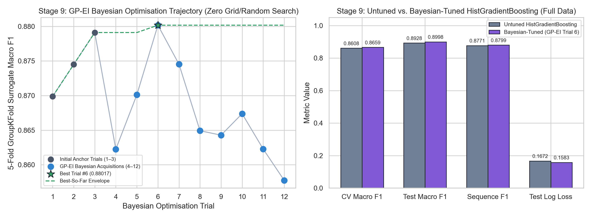

- **Evidence**: [models/bayesian_tuning.py](bayesian_tuning.py) · [models/artifacts/results/bayesian_optimisation_trials.csv](artifacts/results/bayesian_optimisation_trials.csv) · [models/artifacts/results/tuned_vs_untuned_comparison.csv](artifacts/results/tuned_vs_untuned_comparison.csv) · [models/artifacts/plots/stage9_bayesian_tuning_progression.png](artifacts/plots/stage9_bayesian_tuning_progression.png)

---

## Stage 10 — Production Artifacts & Team Handoff

Member 2's outputs plug cleanly into Member 3's HMM/Viterbi route decoder (already integrated on `main`) and Member 4's FastAPI backend:
- **Final Tuned Model**: [models/artifacts/models/selected_best_model_tuned.joblib](artifacts/models/selected_best_model_tuned.joblib) (`1.16 MB`)
- **Untuned Selected Model**: [models/artifacts/models/selected_best_model.joblib](artifacts/models/selected_best_model.joblib) (`0.65 MB`)
- **Serving Interface**: `load_final_model()` and `predict_candidate_probabilities()` exported from [models/__init__.py](__init__.py)
- **Live Monitoring**: [models/artifacts/results/training_status.json](artifacts/results/training_status.json) & `training_progress.log`
- **Complete Technical Reports**: [models/PHASE_1_REPORT.md](PHASE_1_REPORT.md) · [models/README.md](README.md)
