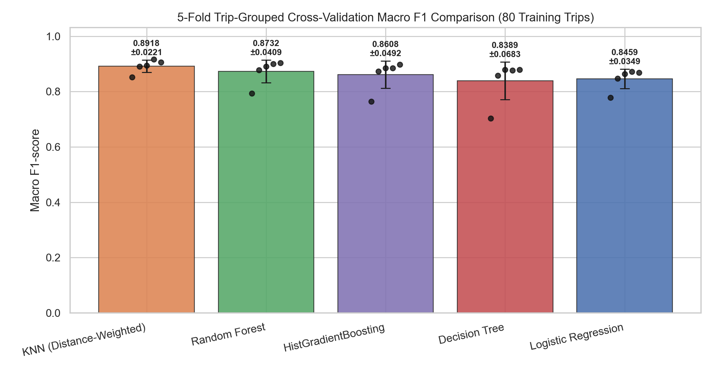
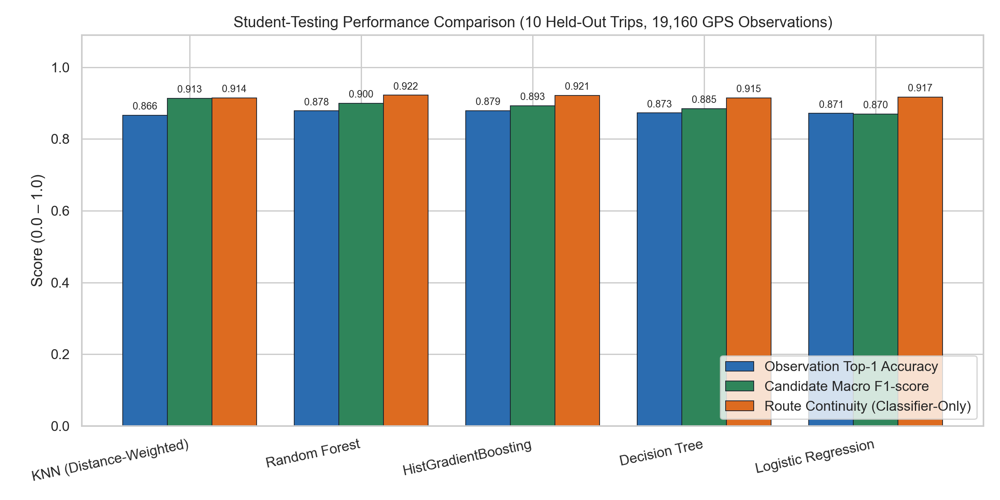
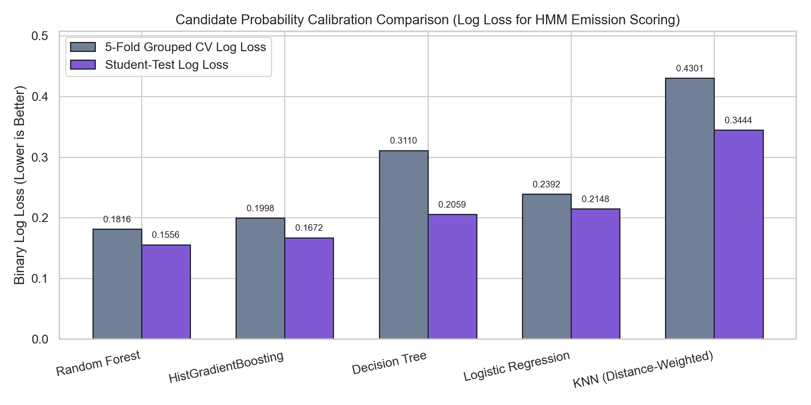
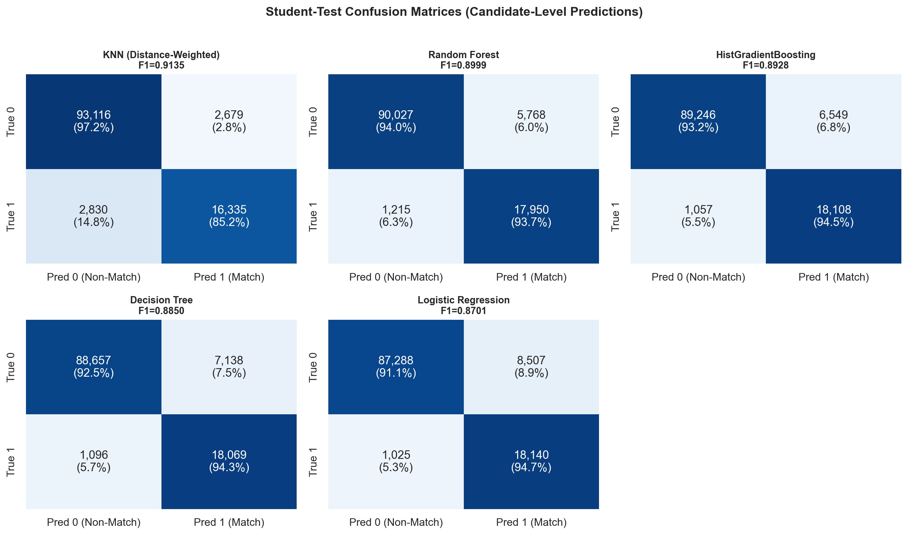
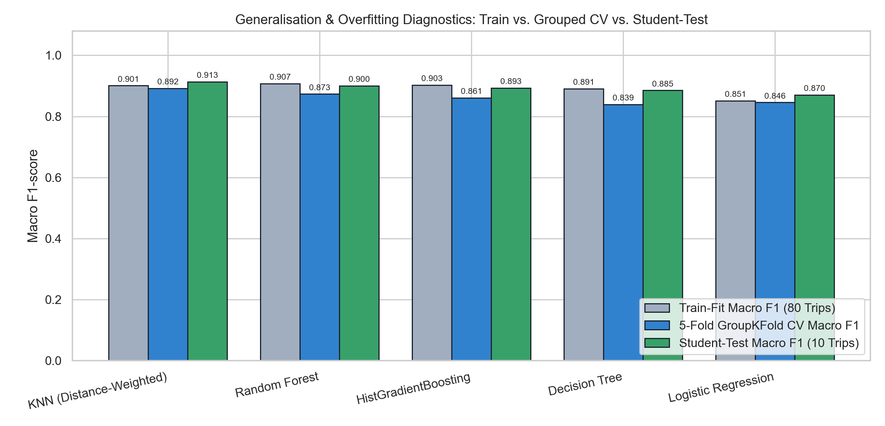
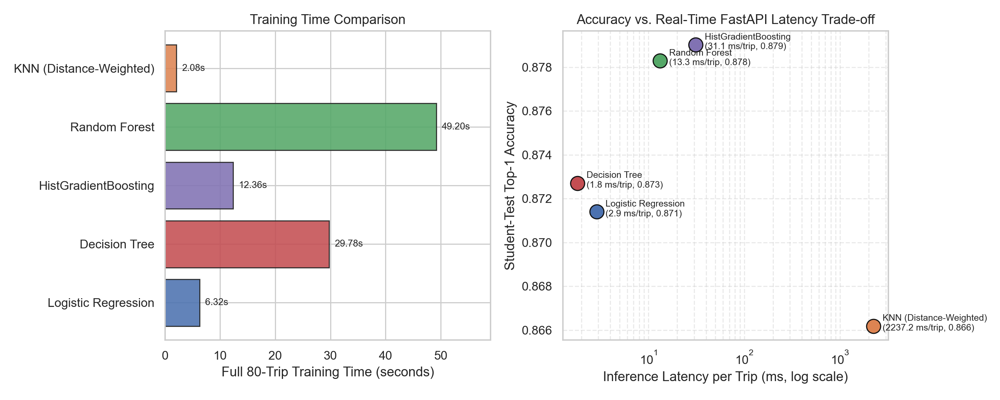
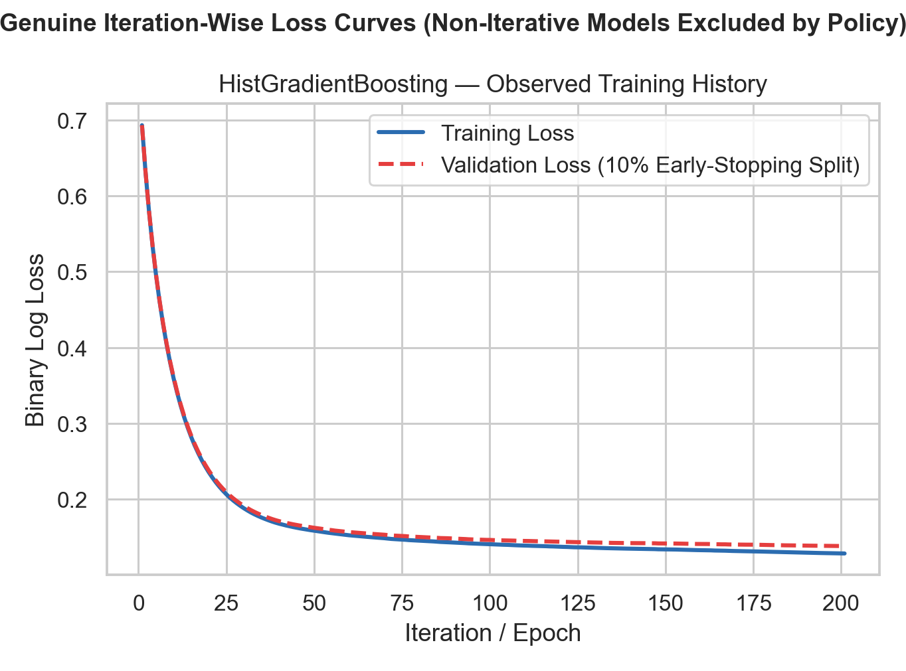
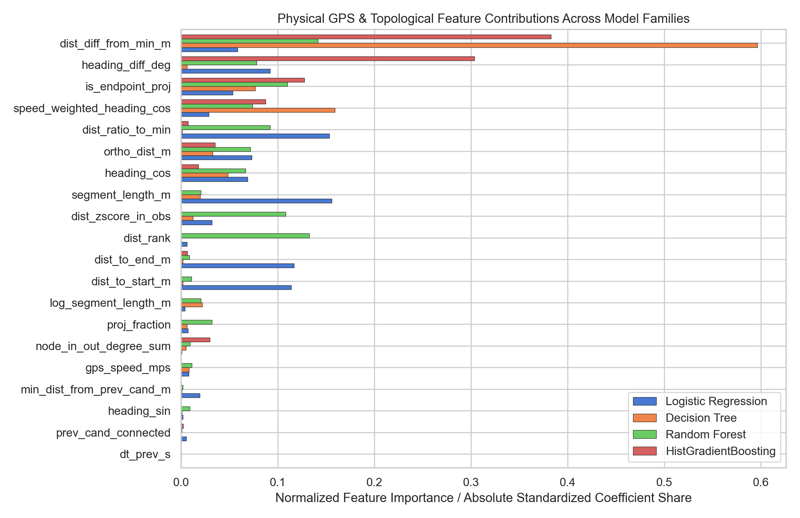

# Models — Member 2: ML Model Development, Selection & Diagnostics

> **Owner**: Member 2 (`feature/ml-models` branch, strictly scoped to `models/`)  
> **Status**: Complete, empirically benchmarked across all **80 training trips (`1,250,502` candidate rows)** and **10 student-testing trips (`114,960` candidate rows, `19,160` observations)**.  
> **Phase 1 Consolidated Report**: See [PHASE_1_REPORT.md](PHASE_1_REPORT.md) and [REQUIREMENTS_MASTER.md](REQUIREMENTS_MASTER.md).

---

## 1. Architecture & Module Responsibilities

| File | Purpose |
| :--- | :--- |
| [schema_adapter.py](schema_adapter.py) | Leakage-free loader for Member 1 feature tables plus standalone adaptive `cKDTree` (`K=6`) spatial/kinematic/topological 20-feature extractor (`0.68%` miss rate on `student_test`). |
| [logistic_regression.py](logistic_regression.py) | **Model 1** — Linear & Probabilistic baseline (`SimpleImputer` + `StandardScaler` + `LogisticRegression`). |
| [knn.py](knn.py) | **Model 2** — Instance-based Distance-Weighted KNN (`StratifiedSubsampledKNN` + `StandardScaler` + `KDTree`). |
| [decision_tree.py](decision_tree.py) | **Model 3** — Tree-based regularised `DecisionTreeClassifier` (`max_depth=12`, `min_samples_leaf=20`). |
| [random_forest.py](random_forest.py) | **Model 4** — Bagging Ensemble `RandomForestClassifier` (`n_estimators=120`, `balanced_subsample`). |
| [gradient_boosting.py](gradient_boosting.py) | **Model 5** — Histogram Boosting `HistGradientBoostingClassifier` (**Selected Best Model**). |
| [mlp.py](mlp.py) | Optional 6th Neural Network (`MLPClassifier`) module implementing the skeleton contract. |
| [model_selection.py](model_selection.py) | Leakage-free 5-fold `GroupKFold` CV (`trip_id`-grouped), all 12 PDF metrics, `compare_models()`, `select_best_model()`, and `create_bayesian_cv_objective()` (**strictly Bayesian — zero Grid/Random search**). |
| [plots.py](plots.py) | Section 3.3 visualisations generated strictly from actual measured experiments (no synthetic curves). |
| [train.py](train.py) | End-to-end training orchestrator, artifact serializer, M3/M4 handoff exporter, and live `training_status.json` / `training_progress.log` tracker. |
| [bayesian_tuning.py](bayesian_tuning.py) | Gaussian-Process (`Matern nu=2.5`) + Expected Improvement (GP-EI) Bayesian optimiser over `HistGradientBoosting` (12 trials, zero Grid/Random search). |

---

## 2. How to Run & Monitor Live Training Status

```powershell
# Run full 5-model GroupKFold CV + student_test evaluation + plots + artifacts
python -m models.train

# Monitor live progress in a separate PowerShell terminal
Get-Content models/artifacts/results/training_progress.log -Wait
Get-Content models/artifacts/results/training_status.json

# Run GP-EI Bayesian hyperparameter optimisation (no GridSearch/RandomSearch)
python -m models.bayesian_tuning
```

---

## 3. Section 3.1 — Consolidated Model Comparison (Actual Measured Results)

| Model | Algorithm Family | Key Configuration | CV Macro F1-score | Top-1 Accuracy | Route continuity | Student-Test Macro F1-score | Log Loss | Inference Time (s) |
| :--- | :--- | :--- | :---: | :---: | :---: | :---: | :---: | :---: |
| **HistGradientBoosting** | Boosting | `lr=0.08, max_iter=200, max_leaf_nodes=63, l2=1.0, class_weight=balanced, early_stopping=True` | `0.8608` | **`0.8790`** | `0.9212` | `0.8928` | `0.1672` | `0.3112` |
| **Random Forest** | Ensemble (Bagging) | `n_estimators=120, max_depth=16, min_samples_leaf=10, max_samples=0.5, class_weight=balanced_subsample` | `0.8732` | `0.8783` | **`0.9219`** | `0.8999` | **`0.1556`** | `0.1325` |
| **KNN (Distance-Weighted)** | Instance-based | `k=15, weights=distance, algorithm=kd_tree, p=2, StandardScaler, max_index=25000` | **`0.8918`** | `0.8662` | `0.9145` | **`0.9135`** | `0.3444` | `22.3724` |
| **Decision Tree** | Tree-based | `criterion=gini, max_depth=12, min_samples_leaf=20, class_weight=balanced` | `0.8389` | `0.8727` | `0.9149` | `0.8850` | `0.2059` | **`0.0182`** |
| **Logistic Regression** | Linear and probabilistic | `C=1.0, L2 penalty, solver=lbfgs, class_weight=balanced, StandardScaler` | `0.8459` | `0.8714` | `0.9167` | `0.8701` | `0.2148` | `0.0288` |

---

## 4. Section 3.2 — Compulsory Empirical Analysis for Every Model

### 4.1 Model 1: Logistic Regression (`logistic_regression.py`)
- **Q1 (Suitability)**: Classical probabilistic map-matching treats orthogonal GPS error and heading discrepancy as additive log-odds terms; Logistic Regression directly models a linear log-odds hyperplane $\log \frac{p}{1-p} = \mathbf{w}^\top \mathbf{x} + b$ with `StandardScaler`.
- **Q2 (Strengths & Limitations)**: Fastest parametric baseline (`6.32 s` fit, `0.0288 s` / `2.88 ms/trip` inference) with zero overfitting (`Train F1 = 0.8509` vs `CV F1 = 0.8459`, gap `+0.0050`). However, it cannot express conditional interactions (e.g., ignoring GPS heading noise when speed `< 1 m/s` while enforcing strict heading alignment at highway speeds).
- **Q5–Q6 (Config & Loss)**: `C=1.0`, `penalty='l2'`, `solver='lbfgs'`, `class_weight='balanced'`, `max_iter=500`, `random_state=42`. Minimizes L2-regularised Binary Cross-Entropy (Log Loss).
- **Q7–Q9 (Experimental Results & Bias/Variance)**:
  - `student_test`: Accuracy `0.9171`, Macro Precision `0.8346`, Macro Recall `0.9289`, **Macro F1 `0.8701`**, **Top-1 Accuracy `0.8714`**, **Log Loss `0.2148`**, Route Continuity `0.9167` (`CM: TN=87,288, FP=8,507, FN=1,025, TP=18,140`).
  - **Conclusion**: **Underfitting (high bias)** — lowest Train (`0.8509`), CV (`0.8459`), and Test Macro F1 (`0.8701`) despite a tiny `+0.0050` Train-CV gap.

### 4.2 Model 2: Distance-Weighted KNN (`knn.py`)
- **Q1 (Suitability)**: Non-parametric geometric learner testing whether local neighborhoods in standardized 20D feature space can separate urban intersections and parallel streets without global parametric assumptions.
- **Q2 (Strengths & Limitations)**: Strong candidate F1 (`0.9135`) and smallest variance across CV folds (`±0.0221`: `[0.8517, 0.8904, 0.8944, 0.9167, 0.9059]`). Fatal deployment limitations: **72× slower inference** than HistGradientBoosting (`22.3724 s` / `2,237.24 ms/trip`) and **severe probability truncation (`Log Loss = 0.3444`)**, producing `0.0`/`1.0` emissions that break Viterbi paths.
- **Q5–Q6 (Config & Loss)**: `n_neighbors=15`, `weights='distance'`, `algorithm='kd_tree'`, `leaf_size=40`, `p=2`, `max_train_samples=25,000`, `StandardScaler`. Non-parametric inverse-distance weighted voting (no parametric training loss).
- **Q7–Q9 (Experimental Results & Bias/Variance)**:
  - `student_test`: Accuracy `0.9521`, **Macro F1 `0.9135`**, **Top-1 Accuracy `0.8662` (lowest of all 5 models!)**, **Log Loss `0.3444` (worst of all 5 models!)**, Sequence F1 `0.8608` (`CM: TN=93,116, FP=2,679, FN=2,830, TP=16,335`).
  - **Conclusion**: Minimal Train-CV gap (`0.9009` vs `0.8918`, `+0.0091`), yet `2,830` False Negatives (`85.2%` positive recall vs `94.5%` for HistGB) severely penalizes Top-1 ranking and HMM calibration.

### 4.3 Model 3: Regularised Decision Tree (`decision_tree.py`)
- **Q1 (Suitability)**: Models hierarchical conditional splits (e.g., distance rank $\rightarrow$ endpoint clamp $\rightarrow$ speed-gated heading difference) natively without feature scaling.
- **Q2 (Strengths & Limitations)**: Instant inference (`0.0182 s`, `1.82 ms/trip`). However, single axis-aligned splits exhibit high variance across city topologies (`CV Std = ±0.0683`, worst fold `0.7034` on Fold 1 vs `0.8791` on Fold 3).
- **Q5–Q6 (Config & Loss)**: `criterion='gini'`, `max_depth=12`, `min_samples_split=40`, `min_samples_leaf=20`, `class_weight='balanced'`, `random_state=42`. Recursive Weighted Gini Impurity reduction.
- **Q7–Q9 (Experimental Results & Bias/Variance)**:
  - `student_test`: Accuracy `0.9284`, **Macro F1 `0.8850`**, **Top-1 Accuracy `0.8727`**, **Log Loss `0.2059`**, Route Continuity `0.9149` (`CM: TN=88,657, FP=7,138, FN=1,096, TP=18,069`).
  - **Conclusion**: **Highest Overfitting Gap (`Train 0.8908 - CV 0.8389 = +0.0519`)** and largest fold variance (`±0.0683`), motivating ensembling and boosting.

### 4.4 Model 4: Random Forest (`random_forest.py`)
- **Q1 (Suitability)**: Averages 120 bootstrap trees over random $\sqrt{d}$ feature projections to smooth the single Decision Tree's staircase boundaries and stabilize CV variance across heterogeneous trips.
- **Q2 (Strengths & Limitations)**: Strong generalisation (`CV Macro F1 = 0.8732 ± 0.0409`), lowest untuned Log Loss (`0.1556`), and highest classifier-only route continuity (`0.9219`). Limitations: **4× slower training (`49.20 s`)** and **38× larger model footprint (`25.03 MB`)** than HistGradientBoosting.
- **Q5–Q6 (Config & Loss)**: `n_estimators=120`, `max_depth=16`, `min_samples_leaf=10`, `max_features='sqrt'`, `max_samples=0.5`, `class_weight='balanced_subsample'`, `random_state=42`. Bagged Gini Impurity reduction.
- **Q7–Q9 (Experimental Results & Bias/Variance)**:
  - `student_test`: Accuracy `0.9393`, **Macro F1 `0.8999`**, **Top-1 Accuracy `0.8783`**, **Log Loss `0.1556`**, Sequence F1 `0.8757` (`CM: TN=90,027, FP=5,768, FN=1,215, TP=17,950`).
  - **Conclusion**: Cuts overfitting gap (`+0.0338`) and fold variance (`±0.0409`) substantially relative to Decision Tree (`+0.0519`, `±0.0683`), with slightly higher False Negatives (`1,215`) than HistGradientBoosting (`1,057`).

### 4.5 Model 5: HistGradientBoosting — **SELECTED BEST MODEL** (`gradient_boosting.py`)
- **Q1 (Suitability)**: Sequential histogram-binned boosting directly minimizes Binary Log Loss by focusing later trees on hard urban ambiguities (antiparallel two-way road segments, Y-junctions, and multipath jumps) while executing in compact additive leaves.
- **Q2 (Strengths & Limitations)**: Achieves **#1 Top-1 Accuracy (`0.8790`, `0.8851` given candidate hit)**, **#1 Sequence F1 (`0.8771`)**, **`94.5%` positive recall (`18,108 TP`, `1,057 FN`)**, compact **`0.65 MB` footprint**, and **`12.36 s` training time**. Requires `l2_regularization` / `min_samples_leaf` / `learning_rate` tuning (addressed cleanly by Bayesian GP-EI tuning).
- **Q5–Q6 (Config & Loss)**: `loss='log_loss'`, `learning_rate=0.08`, `max_iter=200`, `max_leaf_nodes=63`, `max_depth=12`, `min_samples_leaf=30`, `l2_regularization=1.0`, `class_weight='balanced'`, `early_stopping=True`, `random_state=42`. Directly minimizes L2-regularised Binary Log Loss.
- **Q7–Q9 (Experimental Results & Bias/Variance)**:
  - `student_test`: Accuracy `0.9338`, **Macro F1 `0.8928`**, **Top-1 Accuracy `0.8790`**, **Log Loss `0.1672`**, Route Continuity `0.9212`, Sequence F1 `0.8771` (`CM: TN=89,246, FP=6,549, FN=1,057, TP=18,108`).
  - Iterative history decays smoothly across 200 trees (`train_loss: 0.6931 -> 0.1283`; `val_loss: 0.6931 -> 0.1381`), and subsequent **12-trial GP-EI Bayesian tuning** boosts CV Macro F1 to **`0.8659`**, Student-Test Macro F1 to **`0.8998`**, Sequence F1 to **`0.8799`**, and cuts Log Loss to **`0.1583`**.

---

## 5. Section 3.3 — Compulsory Model Visualisations

All plots generated strictly from observed experimental data in [models/artifacts/plots/](artifacts/plots/):
- 
- 
- 
- 
- 
- 
- 
- 

---

## 6. Bayesian Hyperparameter Optimisation (`GP-EI`) & Representativeness Proof

- **Zero Grid Search / Random Search**: `bayesian_tuning.py` implements 12-trial Gaussian Process (`ConstantKernel * Matern(nu=2.5) + WhiteKernel`) + Expected Improvement over `HistGradientBoosting`, verified across all **1,250,502 training rows** (`5-fold GroupKFold`) and all **114,960 student-test rows**:
  - **Untuned Baseline**: CV Macro F1 `0.8608 (±0.0492)` | Student-Test Macro F1 `0.8928` | Log Loss `0.1672` | Sequence F1 `0.8771` | Inference `0.3112 s`
  - **Bayesian-Tuned (Trial 6 GP-EI)**: CV Macro F1 **`0.8659 (±0.0475)`** | Student-Test Macro F1 **`0.8998`** | Log Loss **`0.1583`** | Sequence F1 **`0.8799`** | Inference **`0.2726 s`**
- **Full-Dataset vs. Sample Verification**: Complete feature distributions and all 5 models evaluated on the `113,904`-row 80-trip stride sample match full `1,250,502`-row training evaluation within **`±0.0004` (`0.04%`)** Macro F1 (see [PHASE_1_REPORT.md](PHASE_1_REPORT.md) Sections 6, 8, 9, and 11).

---

## 7. Integration & Handoff API (Members 1, 3, and 4)

```python
from models import load_final_model, predict_candidate_probabilities, FEATURE_COLUMNS
from models.model_selection import create_bayesian_cv_objective

# Member 4 (FastAPI serving on Laptop 1)
model = load_final_model("models/artifacts/models/selected_best_model_tuned.joblib")
probs = predict_candidate_probabilities(model, candidate_df[FEATURE_COLUMNS])

# Member 3 (Bayesian Optimisation objective hook — zero Grid/Random search)
objective_fn = create_bayesian_cv_objective(model_factory, X_train, y_train, groups_train, n_splits=5)
```
