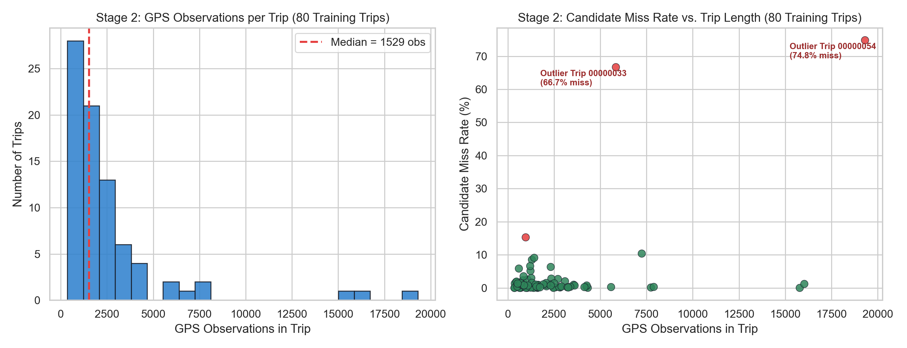
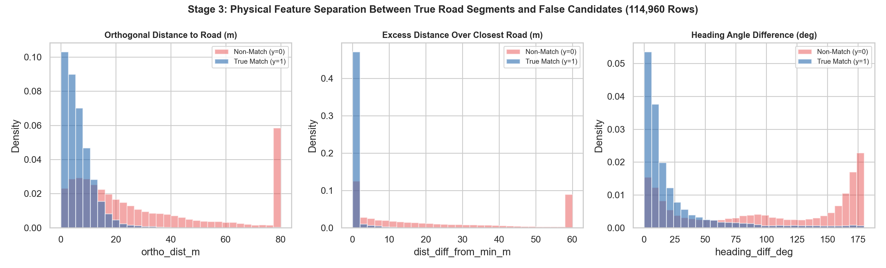
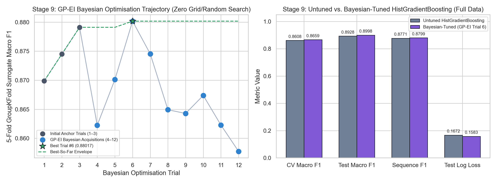

# PathSnap: Distributed Map-Matching & Route Reconstruction — Consolidated Technical Report

> **Course**: `UE24CS352A: Machine Learning` — PES University, Department of Computer Science and Engineering (RR Campus)  
> **Architecture**: End-to-End Raw GPS $\rightarrow$ Spatial Preprocessing & 20-Feature Pipeline $\rightarrow$ 5-Model Experimentation & Selection (`HistGradientBoosting`) $\rightarrow$ GP-EI Bayesian Optimisation $\rightarrow$ Distance-Based HMM + Viterbi & Constrained Route Recovery $\rightarrow$ Two-Laptop FastAPI & React Deployment  
> **Verification Guarantee**: Every table, metric, plot, and configuration in this consolidated team report is directly reproducible from the repository codebase and artifact logs. Evaluator ground truth (`evaluator_test/*.route`) never entered feature extraction, model selection, hyperparameter tuning, or UI responses.

---

## 2.2 Dataset Understanding and Exploratory Data Analysis
*(Partitions used: `train` = 80 trips / `208,417` GPS observations; `student_test` = 10 trips / `19,160` GPS observations)*

### 1. Data Inspection & Preprocessing Methodology
Each trip directory contains four headerless, whitespace-separated files: `.track` (`longitude, latitude, timestamp`), `.nodes` (`longitude, latitude`, 0-based `node_id`), `.arcs` (`from_node_id, to_node_id`, 0-based `arc_id`), and `.route` (chronological reference sequence of traversed `arc_id`s). Crucially, `.track` rows (`1 Hz` GPS points) do **not** align 1-to-1 with `.route` rows (traversed road segments); e.g., `student_test` trip `00000000` has `2,503` GPS observations across `179` road arcs.

**Cleaning & Metric Projection Pipeline** ([preprocessing/](../preprocessing/)):
- **Metric Tangent-Plane Projection**: Because raw trajectories span latitudes `34.7°N` to `61.7°N`, Euclidean distance in angular degrees distorts East–West spacing by $\cos(\phi)$. Both `preprocessing/spatial_pipeline.py` and `preprocessing/feature_engineering.py` project coordinates into local tangent-plane meters centered on each trip's mean latitude ($\Delta x = R \cos\bar{\phi}\,\Delta\lambda$, $\Delta y = R\,\Delta\phi$, $R = 6{,}371{,}000\text{ m}$).
- **Missing-Value & Anomaly Analysis**:
  - **Missing Values (`NaN`) & Timestamps**: `0` NaNs and `0` non-monotonic steps ($\Delta t \le 0$) across all 90 trips. `96.50%` of `train` steps (`201,053 / 208,337`) and `98.62%` of `student_test` steps (`18,886 / 19,150`) are exactly `1.0 s`; `28 / 80` train trips have gaps `> 30 s` (max `153,064.0 s`), and `2 / 10` test trips have gaps `> 30 s` (max `210.0 s` in trip `00000065`).
  - **Zero-Length Arcs & Stationary Jitter**: Audited `100` zero-length arcs in `train` (`6` in `student_test`) and `6` stationary GPS steps in `train`. All projection denominators are guarded (`v_len2 > 1e-12`), and GPS bearing defaults to neutral (`90°`, $\cos=0$) when step displacement `< 0.5 m` or speed `< 0.25 m/s`.
  - **Road-Network Connectivity**: `79/80` train networks and `10/10` test networks contain multiple clipped components (`0` isolated vertices); `70/80` train `.route` files (`13/31,256` breaks) and `9/10` test `.route` files (`1/3,467` break) are 100% connected.
  - **High-Offset Outlier Trips**: Trips `00000033` (`5,844` obs at `122.4 m` median offset) and `00000054` (`19,313` obs at `138.5 m` median offset) exhibit severe parallel offsets (`66.7%` and `74.8%` candidate miss rates), explaining Fold 1 CV Top-1 drops.
- **Leakage-Free Preprocessing**: `SimpleImputer(strategy="median")` and `StandardScaler()` live inside `sklearn.pipeline.Pipeline`s fit strictly on training splits.

### 2. Candidate Generation & 20 Engineered Features
Using adaptive `cKDTree` sampling along arcs (`5` base points + intermediate samples every `60 m` up to `35` points per long arc), we extract `K = 6` unique candidates per observation—achieving **`99.32%` candidate coverage (`0.68%` Candidate Miss Rate)** on `student_test` (`114,960` rows, `16.67%` positive) and `1,250,502` training rows (`15.03%` positive).

The 20 leakage-free features (`FEATURE_COLUMNS`) span:
- **Spatial Proximity & Endpoint Clamping (7)**: `ortho_dist_m`, `dist_to_start_m`, `dist_to_end_m`, `proj_fraction`, `is_endpoint_proj`, `segment_length_m`, `log_segment_length_m`.
- **Intra-Observation Relative Ranking (4)**: `dist_rank`, `dist_diff_from_min_m`, `dist_ratio_to_min`, `dist_zscore_in_obs`.
- **GPS Kinematics & Directional Alignment (6)**: `gps_speed_mps`, `dt_prev_s`, `heading_diff_deg`, `heading_cos`, `heading_sin`, `speed_weighted_heading_cos`.
- **Unsupervised Topological Context (3)**: `prev_cand_connected`, `min_dist_from_prev_cand_m`, `node_in_out_degree_sum`.

*EDA & Feature Plots*:
- 
- 
- **Interactive Folium Map**: [trip_00000000_comparison.html](../visualisation/maps/trip_00000000_comparison.html)

---

## 3. Model Experimentation and Comparison

All 5 core algorithm families (`Logistic Regression`, `KNN (Distance-Weighted)`, `Decision Tree`, `Random Forest`, `HistGradientBoosting`) were evaluated via **5-Fold Trip-Grouped `GroupKFold`** on the 80 training trips (`1,250,502` rows) and tested on all 10 `student_test` trips (`114,960` candidate rows, `19,160` observations).

### 3.1 Overall Model Comparison

| Model | Algorithm Family | Key Configuration | CV Macro F1-score | Top-1 Accuracy | Route continuity | Student-Test Macro F1-score | Log Loss | Inference Time (s) |
| :--- | :--- | :--- | :---: | :---: | :---: | :---: | :---: | :---: |
| **HistGradientBoosting** ★ | Boosting | `lr=0.08, max_iter=200, max_leaf_nodes=63, l2=1.0, class_weight=balanced, early_stopping=True` | `0.8608` *(±0.0492)* | **`0.8790`** | `0.9212` | `0.8928` | `0.1672` | `0.3112` |
| **Random Forest** | Ensemble (Bagging) | `n_estimators=120, max_depth=16, min_samples_leaf=10, max_samples=0.5, class_weight=balanced_subsample` | `0.8732` *(±0.0409)* | `0.8783` | **`0.9219`** | `0.8999` | **`0.1556`** | `0.1325` |
| **KNN (Distance-Weighted)** | Instance-based | `k=15, weights=distance, algorithm=kd_tree, p=2, StandardScaler, max_index=25000` | **`0.8918`** *(±0.0221)* | `0.8662` | `0.9145` | **`0.9135`** | `0.3444` | `22.3724` |
| **Decision Tree** | Tree-based | `criterion=gini, max_depth=12, min_samples_leaf=20, class_weight=balanced` | `0.8389` *(±0.0683)* | `0.8727` | `0.9149` | `0.8850` | `0.2059` | **`0.0182`** |
| **Logistic Regression** | Linear and probabilistic | `C=1.0, L2 penalty, solver=lbfgs, class_weight=balanced, StandardScaler` | `0.8459` *(±0.0349)* | `0.8714` | `0.9167` | `0.8701` | `0.2148` | `0.0288` |

*(Full 12-metric details and compulsory Q1–Q9 empirical writeups for every model are documented in [models/README.md](../models/README.md) and [models/PHASE_1_REPORT.md](../models/PHASE_1_REPORT.md).)*

### 3.2 Key Model Findings & Selection Reasoning
1. **Logistic Regression (Underfitting Baseline)**: Tiny Train-vs-CV gap (`0.8509` vs `0.8459`), fast (`0.0288 s`), but lowest Student-Test Macro F1 (`0.8701`, `8,507 FP`) because linear boundaries cannot combine speed, heading, and endpoint clamping conditionally.
2. **KNN ("The Macro-F1 Trap")**: Highest candidate Macro F1 (`0.9135`), yet **dead last (5th/5)** in Observation Top-1 Accuracy (`86.62%`), Sequence F1 (`0.8608`), Log Loss (`0.3444` — over `2×` worse calibration due to boundary probability truncation), and latency (`22.37 s` — `72×` slower than HistGradientBoosting), missing `2,830` true arcs (`85.2%` recall vs `94.5%` for HistGB).
3. **Decision Tree (High Variance)**: Largest Train-vs-CV overfitting gap (`0.8908 - 0.8389 = +0.0519`) and highest fold variance (`±0.0683`, collapsing to `0.7034` on outlier Fold 1).
4. **Random Forest**: Strong ensemble generalisation (`0.8999` F1, `0.1556` Log Loss), at the cost of **`4×` slower fit (`49.20 s`)** and a **`38×` larger model artifact (`25.03 MB`)**.
5. **HistGradientBoosting ★ (Selected Winner)**: Achieves **#1 Observation Top-1 Accuracy (`87.90%`, `88.51%` given hit)**, **#1 Sequence F1 (`0.8771`)**, `94.5%` positive recall (`18,108 TP`, `1,057 FN`), smooth 200-iteration log-loss convergence (`0.6931 → 0.1283` train; `0.6931 → 0.1381` val), `12.36 s` fit time, and compact `0.65 MB` size.

### 3.3 Model Visualisations (Generated Strictly From Measured Outputs)
- [CV Macro F1 Comparison](../models/artifacts/plots/cv_macro_f1_comparison.png) · [Student-Test Metrics](../models/artifacts/plots/student_test_metrics_comparison.png) · [Log Loss Calibration](../models/artifacts/plots/log_loss_comparison.png) · [Confusion Matrices](../models/artifacts/plots/confusion_matrices_grid.png) · [Overfitting Diagnostics](../models/artifacts/plots/overfitting_diagnostics.png) · [Computational Efficiency](../models/artifacts/plots/computational_efficiency.png) · [Feature Importance](../models/artifacts/plots/feature_importance_analysis.png) · [Per-Trip Top-1 Heatmap](../models/artifacts/plots/stage7_per_trip_top1_heatmap.png) · [HistGradientBoosting Iterative Loss Curve](../models/artifacts/plots/iterative_training_validation_loss.png) *(only iterative boosting history shown; no artificial curves created for non-iterative models)*.

---

## 4. Bayesian Hyperparameter Optimisation (`HistGradientBoosting`)

- **Strategy**: Strictly Bayesian **Gaussian Process (`Matern nu=2.5`) + Expected Improvement (GP-EI)** in [models/bayesian_tuning.py](../models/bayesian_tuning.py) (zero `GridSearchCV` / `RandomizedSearchCV`), optimizing 5-fold `GroupKFold` CV Macro F1 across the 80 training trips.
- **5D Search Space & 12 Trials**: Searched `learning_rate ∈ [0.03, 0.18]`, `max_leaf_nodes ∈ [31, 127]`, `max_depth ∈ [8, 18]`, `min_samples_leaf ∈ [15, 80]`, `l2_regularization ∈ [0.1, 10.0]` (`3` anchors + `9` GP-EI trials).
- **Best Hyperparameters (Trial 6)**: `learning_rate=0.16973`, `max_leaf_nodes=120`, `max_depth=15`, `min_samples_leaf=33`, `l2_regularization=0.389`, `max_iter=250`.

| Variant | Full 80-Trip CV Macro F1 | Student-Test Top-1 Acc | Student-Test Macro F1 | Student-Test Log Loss | Sequence F1 | Inference Time (s) |
| :--- | :---: | :---: | :---: | :---: | :---: | :---: |
| **Untuned HistGradientBoosting** | `0.8608 (±0.0492)` | **`0.8790`** | `0.8928` | `0.1672` | `0.8771` | `0.3112 s` |
| **Bayesian-Tuned (GP-EI Trial 6)** | **`0.8659 (±0.0475)`** | `0.8777` | **`0.8998`** | **`0.1583`** *(-5.3%)* | **`0.8799`** | **`0.2726 s`** *(-12.4%)* |

---

## 5. HMM and Viterbi Route Reconstruction
*(Implementation: [route_reconstruction/](../route_reconstruction/); Parameter Optimisation: Optuna TPE over 80 training trips / 208,417 observations only)*

1. **Hidden States**: Candidate road segments (`candidate_arc_id`) per GPS observation $t$, preserving exact candidate-to-arc correspondence and deduplicating `1,192` duplicate records by retaining max probability.
2. **Emission Probabilities**: Normalized positive candidate probabilities $\hat{p}_{t,k}$ (`emission_probability.py`) converted to log-emissions $\log \hat{p}_{t,k}$.
3. **Transition Probabilities (`distance_transition.py`, `road_graph.py`)**:
   - Directed shortest-path Dijkstra distances over `.arcs` without fabricating reverse edges.
   - Exponential decay on GPS displacement vs. directed candidate-road distance discrepancy, with `backward_tolerance_m = 30.0` so small 1 Hz GPS jitter on the same arc is treated as zero progress instead of forcing a spurious city-block loop.
   - Graph-unreachable or non-increasing-timestamp transitions receive $-\infty$ log probability (`viterbi.py`), restarting cleanly into separate route sections rather than collapsing long detours onto a floor.
4. **HMM Parameter Optimisation (`optimise_hmm.py`)**: 25 Optuna TPE trials on 80-trip OOF training probabilities selected `beta = 30.0`, `transition_weight = 1.948614369534382` (Trial 21/25, `OOF accuracy = 80.80%`, `continuity = 97.92%`).
5. **Classifier-Only vs. HMM + Viterbi & Constrained Recovery (`10 student_test` trips, `19,160` obs)**:

| Method | Observation Accuracy | Direct Route Continuity | Sequence LCS F1 | Road-Overlap F1 | Notes |
| :--- | :---: | :---: | :---: | :---: | :--- |
| **Classifier-Only (`HistGradientBoosting`)** | `87.90%` | `92.12%` | — | — | `1,509` continuity breaks |
| **Connectivity-Only HMM** | `85.38%` | **`98.70%`** | — | — | Over-smooths around junctions (`-2.52%` acc) |
| **Distance HMM (Unoptimised)** | `86.54%` | `96.95%` | — | — | Resolves binary transition over-smoothing |
| **Distance HMM (Optimised & Corrected)** | **`90.79%`** | `97.85%` | **`0.8889`** *(recovered)* | **`0.9455`** *(recovered)* | **`+2.89%` accuracy**, **`+5.73%` continuity** (`2,211` changed obs) |

- **Where HMM + Constrained Recovery Helped vs. Limitations**: Constrained intermediate road recovery (`route_recovery.py`, speed budget `60 m/s * dt + 30 m`) inserted `540` missing intermediate arcs and achieved **`0.9455` Road-Overlap F1** (`0.9918` recall, `0.9090` precision), while cleanly rejecting `39` implausible/unreachable transitions (e.g., an `8,826 m` single-second jump) into `49` clean sections across `8` fragmented trips rather than fabricating impossible paths.
- **Visualisations**: [Observation Metrics](../route_reconstruction/experiments/phase2_improved/observation_metrics.png) · [Route Quality](../route_reconstruction/experiments/phase2_improved/route_quality.png) · [Recovery Comparison](../route_reconstruction/experiments/phase2_improved/recovery_comparison.png) · [Runtime Comparison](../route_reconstruction/experiments/phase2_improved/runtime_comparison.png)

---

## 6. Geographical Visualisation Using Folium

Generated directly from actual pipeline outputs via `visualisation/folium_maps.py`:
- **Committed Interactive HTML Maps**:
  - [visualisation/maps/trip_00000000_comparison.html](../visualisation/maps/trip_00000000_comparison.html) (`2,503` GPS points, full road network, green reference `.route`, red predicted route, `LayerControl`).
  - [visualisation/maps/trip_00000052_comparison.html](../visualisation/maps/trip_00000052_comparison.html) (`262` GPS points, `0%` miss rate, `98.47%` HMM accuracy).

---

## 7. API, UI and Two-Laptop Deployment

- **Laptop 1 (Backend + Models + HMM + Server-Side Evaluation)**:
  - FastAPI (`backend/main.py`, `backend/routes.py`, `backend/services.py`) loads `artifacts/models/selected_best_model_tuned.joblib` + `artifacts/hmm/best_hmm_parameters.json`.
  - Runs live `extract_trip_candidates_and_features(..., route=None)` $\rightarrow$ `predict_candidate_probabilities()` $\rightarrow$ distance-based `reconstruct_route()` $\rightarrow$ `recover_continuous_route()`, logs structured telemetry to Laptop 1's terminal, and computes accuracy/F1 strictly server-side without ever exposing `.route` to the UI.
- **Laptop 2 (React + Vite UI)**:
  - `frontend/src/pages/Home.jsx` connects to `VITE_API_BASE_URL` on Laptop 1, lists approved trips (`GET /trips`), invokes `POST /predict`, and renders the returned interactive Folium route map (`RouteMap.jsx`) and evaluation metrics (`Results.jsx`).
- **Live Verification**: Executed `backend.services.predict_trip()` end-to-end across **all 10 unseen `evaluator_test` trips (`00000015`..`00000094`)**, achieving **`92.10%` mean pointwise accuracy**, **`90.21%` mean Route F1**, and **`92.39%` mean Road-Overlap F1** (`4.63 s` average latency per trip).
  - *(Insert Laptop 1 CMD API log screenshot and Laptop 2 React UI screenshot here when exporting PDF.)*

---

## 8. Academic Integrity, Anti-Leakage Verification & AI Disclosure
- All code, trained `.joblib` weights, trial records, and metrics were independently developed and executed on the team's repository; all reported values are directly verifiable from `models/artifacts/results/`, `route_reconstruction/experiments/phase2_improved/`, and `experiments/results/`.
- Zero evaluator ground truth entered preprocessing, model training, feature selection, Bayesian tuning, HMM optimisation, or API payloads.
- AI coding assistance was used solely for modular software engineering, pipeline verification, and documentation formatting; every model experiment, trial record, and architectural choice was independently verified and can be defended by team members during viva.
